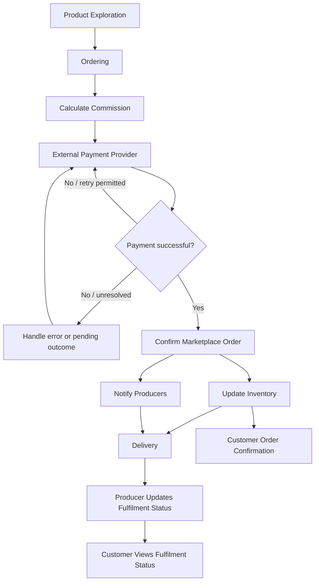

# Bristol Regional Food Network – Digital Marketplace
## Major and Minor Features Specification

**Document type:** Product Feature Specification  
**Version:** 1.1  
**Status:** Initial proposal

## 1. Purpose

This document defines the major and minor features of the Bristol Regional Food Network Digital Marketplace. It establishes the feature hierarchy that will guide development, testing, and prioritisation.

The marketplace connects customers with local food producers. Customers can explore products, purchase products from multiple producers in a single marketplace order, make payments through an external payment provider, and receive order and delivery or collection information.

The system is organised around three major features:

1. Ordering
2. Product Exploration
3. Delivery

## 2. Initial Release Scope

The initial release will support the complete core marketplace workflow.

The system will allow customers to:

- Browse and search for local food products.
- View product prices, producer information, and availability.
- Add products from multiple producers to a basket.
- Review and amend their basket.
- Proceed to checkout, where stock is rechecked and reserved for 10 minutes.
- Review the order and its total cost.
- Complete payment through an integrated external payment provider.
- Retry payment when the payment provider reports an error or permits another attempt.
- Receive confirmation after successful payment and order processing.
- View delivery or collection arrangements for each relevant producer.

The system will also support:

- One overall marketplace order containing separate producer-specific order elements.
- Stock validation, temporary stock reservations, and inventory updates.
- A 5% marketplace commission on the agreed commissionable product amount.
- Producer accounts and access to their own confirmed order information.
- Producer notifications following successful order confirmation.
- Producer updates to confirm successful delivery or collection.
- Immutable audit records retained indefinitely in the initial release.

The external payment provider will handle payment processing and payment-related retry behaviour. The marketplace must integrate with the provider and coordinate its responses with the order workflow.

Delivery charges are included in the prices listed by producers and are not charged separately by the marketplace. The marketplace does not manage producer delivery charges as a separate platform fee.

The minimum preparation period is two business days, calculated from the end of the business day on which the order is placed to the end of the second subsequent business day. For example, an order placed on Wednesday will be due for fulfilment no earlier than Friday, subject to the applicable business-day calendar.

Live payment processing will be handled by the external provider rather than simulated within the marketplace. Testing arrangements must be agreed with the provider, such as its sandbox or test environment.

## 3. Feature Summary

| Major Feature | Minor Feature Groups |
|---|---|
| Ordering | Basket management; checkout and order review; external payment integration; order creation and confirmation; audit records |
| Product Exploration | Product catalogue; product search; product categories; product origin and provenance |
| Delivery | Fulfilment information; customer order confirmation; producer access; fulfilment updates |

## 4. Cross-Feature Dependencies

The following diagram illustrates how the three major features connect to one another and how payment, stock validation, order confirmation, and fulfilment fit into the overall workflow.

## 5. Major Feature 1: Ordering

**Description:** Enables customers to select products, manage their basket, review their purchase, complete payment through the external payment provider, and create a confirmed marketplace order.

Ordering includes basket management, checkout, payment integration, order confirmation, stock management, and commission calculations.

### 5.1 Basket Management

- **ORD-01 – Add products to basket:** Customers can add available products to their basket.
- **ORD-02 – View basket:** Customers can view selected products, quantities, prices, and associated producers.
- **ORD-03 – Update quantities:** Customers can increase or decrease product quantities.
- **ORD-04 – Remove products:** Customers can remove individual products from their basket.
- **ORD-05 – Calculate subtotal:** The system calculates the subtotal using product prices and selected quantities.
- **ORD-06 – Support multiple producers:** Customers can add products from different producers to the same basket while preserving each item's producer association.
- **ORD-07 – Recheck stock at checkout:** The system rechecks the availability of every requested product when the customer proceeds from the basket to the ordering stage.
- **ORD-08 – Reserve stock for 10 minutes:** Following successful stock validation, the system reserves the requested quantities for 10 minutes.
- **ORD-09 – Handle insufficient stock:** The system identifies unavailable products or insufficient quantities and allows the customer to amend the basket.
- **ORD-10 – Handle expired reservations:** If a reservation expires before the order is completed, the system revalidates stock before proceeding.
- **ORD-11 – Review fulfilment arrangements:** Customers can review the delivery or collection arrangements applicable to each producer.

### 5.2 Checkout and Order Review

- **ORD-12 – Review order:** Customers can inspect their order before payment.
- **ORD-13 – Display itemised costs:** The system displays products, quantities, unit prices, and producer associations.
- **ORD-14 – Calculate total payable:** The system calculates the total using the listed product prices and applicable adjustments.
- **ORD-15 – Display delivery-inclusive prices:** Producer-listed prices, including any delivery costs incorporated by the producer, are used without adding a separate marketplace delivery charge.
- **ORD-16 – Validate preparation lead time:** Where fulfilment dates are selected, the system applies the two-business-day preparation rule.

### 5.3 External Payment Integration

- **ORD-17 – Integrate external payment provider:** The marketplace sends payment requests to an external payment provider using its supported integration interface.
- **ORD-18 – Handle successful payment:** The system processes a successful payment response and continues the order-confirmation workflow.
- **ORD-19 – Handle declined or failed payment:** The system communicates the payment outcome and leaves the order unconfirmed unless payment succeeds.
- **ORD-20 – Handle payment errors and retries:** The marketplace supports the retry process provided by the external payment provider and allows the customer to retry when permitted.
- **ORD-21 – Handle pending or uncertain outcomes:** The system follows the provider's status-checking or recovery mechanism when the outcome of a payment attempt is uncertain.
- **ORD-22 – Prevent duplicate processing:** Repeated requests, callbacks, or retries must not create duplicate confirmed orders or duplicate charges.
- **ORD-23 – Coordinate payment and stock reservation:** The system handles payment attempts and the 10-minute stock reservation without confirming an order that cannot be fulfilled.

### 5.4 Order Creation and Confirmation

- **ORD-24 – Create marketplace order:** The system creates one overall order for the customer's purchase.
- **ORD-25 – Create producer-specific order elements:** The overall order contains separate order elements for each relevant producer.
- **ORD-26 – Preserve order item details:** Each item retains its producer, quantity, and purchase price.
- **ORD-27 – Generate order reference:** The system generates a unique reference for each confirmed marketplace order.
- **ORD-28 – Confirm order:** The system confirms the order only after successful payment and completion of required validations.
- **ORD-29 – Update inventory:** Stock is committed or deducted in accordance with successful order confirmation and the reservation mechanism.
- **ORD-30 – Calculate marketplace commission:** The system calculates the marketplace's 5% commission on the agreed commissionable product amount.
- **ORD-31 – Record producer allocations:** The system records the amount attributable to each producer and the corresponding commission.
- **ORD-32 – Notify producers:** Each relevant producer is notified of their confirmed order items and quantities.

### 5.5 Audit Records

- **ORD-33 – Record transactions:** The system records order references, payment outcomes, order totals, producer allocations, and commission amounts.
- **ORD-34 – Retain audit records indefinitely:** Audit records are retained indefinitely in the initial release.
- **ORD-35 – Protect audit records from alteration:** Recorded audit information cannot be edited or deleted through normal application functionality.

## 6. Major Feature 2: Product Exploration

**Description:** Enables customers to discover local food products, search the catalogue, assess product availability, and access producer and origin information.

### 6.1 Product Catalogue

- **EXP-01 – Browse products:** Customers can browse products available through the marketplace.
- **EXP-02 – Display product information:** Product listings display product names, descriptions, and prices.
- **EXP-03 – Display producer information:** Listings identify the producer associated with each product.
- **EXP-04 – Display availability:** Product listings indicate whether products are available or unavailable.
- **EXP-05 – Identify unavailable products:** Unavailable products are clearly distinguished so customers can make informed purchasing decisions.

### 6.2 Product Search

- **EXP-06 – Search by product name:** Customers can search for products by name.
- **EXP-07 – Display matching results:** The system displays products matching the search.
- **EXP-08 – Handle empty results:** The system displays an appropriate message when no products match the search.

### 6.3 Product Categories

- **EXP-09 – Browse by category:** Customers can browse products within configured categories.
- **EXP-10 – Filter by food type:** Customers can filter products using categories such as vegetables, dairy, bakery goods, preserves, and seasonal specialities.

### 6.4 Product Origin and Provenance

- **EXP-11 – View producer details:** Customers can access information about the producer of a product.
- **EXP-12 – View product origin:** Customers can view available farm or product-origin information.

## 7. Major Feature 3: Delivery

**Description:** Enables customers and producers to understand and manage the fulfilment stage of confirmed marketplace orders, including delivery and collection arrangements and fulfilment status.

The marketplace must preserve producer-specific fulfilment arrangements. Producers are responsible for their own delivery or collection operations and for updating the fulfilment status.

### 7.1 Fulfilment Information

- **DEL-01 – Display fulfilment method:** The system identifies the applicable delivery or collection method for each producer.
- **DEL-02 – Display fulfilment instructions:** Customers receive available delivery or collection instructions.
- **DEL-03 – Preserve producer-specific arrangements:** The system displays the correct fulfilment information for each producer represented in the order.
- **DEL-04 – Apply preparation lead time:** Fulfilment scheduling, where included, respects the two-business-day preparation rule.

### 7.2 Customer Order Confirmation Summary

- **DEL-05 – Display order reference:** Customers can view the reference for their confirmed order.
- **DEL-06 – Display purchased items:** Customers can review the products and quantities included in the order.
- **DEL-07 – Display order total:** Customers can view the total payable and payment status.
- **DEL-08 – Display fulfilment details:** Customers can review the relevant delivery or collection arrangements after confirming their order.

### 7.3 Producer Access and Fulfilment Updates

- **DEL-09 – Authenticate producers:** Producers can access the producer-facing functionality through their accounts.
- **DEL-10 – Restrict producer order access:** Producers can view the order information relevant to their own products and fulfilment responsibilities.
- **DEL-11 – View producer-specific orders:** Producers can view confirmed products and quantities they must fulfil.
- **DEL-12 – Update successful fulfilment:** Producers can update the relevant fulfilment status to indicate that goods have been delivered or collected successfully.
- **DEL-13 – Restrict fulfilment updates:** Only the relevant authorised producer can update the fulfilment status for their order items.
- **DEL-14 – Display fulfilment status:** Customers can view the latest recorded fulfilment status for their order.
